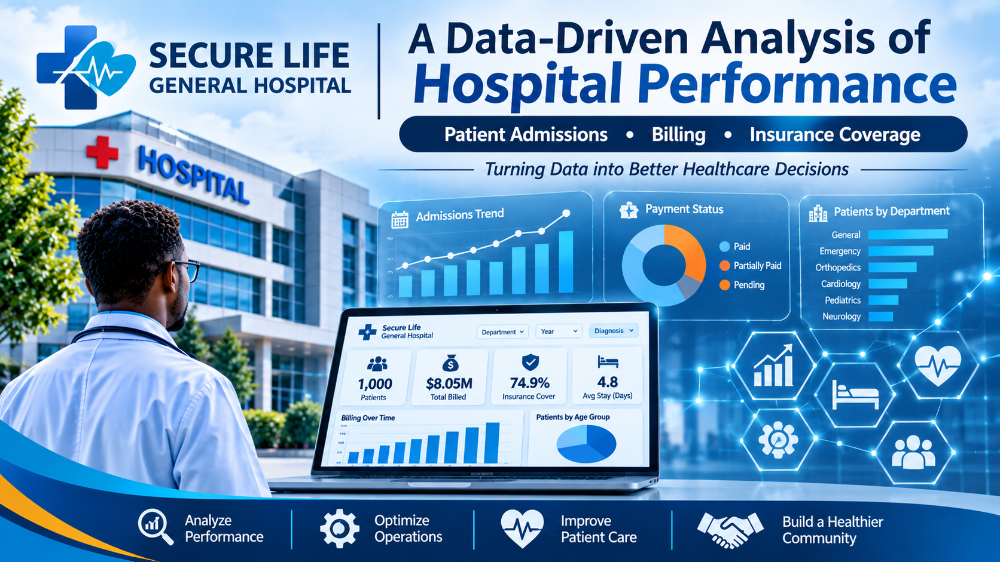
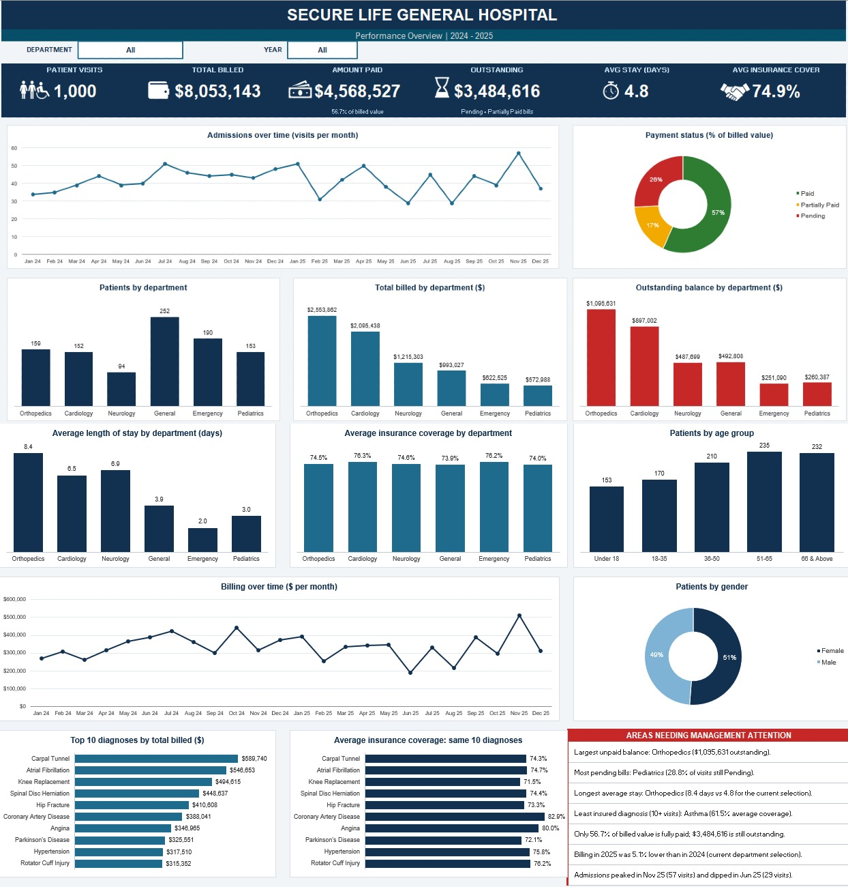

# A Data-Driven Analysis of Secure Life General Hospital Performance 2024-2025

## Introduction

Secure Life General Hospital treats patients across six departments. Management has noticed shifts in admissions, unpaid medical bills and insurance coverage, but has no single report showing how the hospital is performing operationally and financially.
This project turns the hospital's raw patient records into an interactive Microsoft Excel dashboard. It uses PivotTables, PivotCharts, slicers and KPI cards so that management can monitor admissions, billing and payments, and filter the results by department, year and diagnosis.

## About the Dataset

The dataset holds 1,000 patient visits recorded between 1 January 2024 and 28 December 2025. Each row is one patient visit, not necessarily one unique patient, so a patient can appear more than once. It has no missing values.

| **Field** | **Description** |
|---|---|
| Patient ID | Unique ID for each visit record. |
| Patient Name | Name of the patient treated. |
| Age | Patient's age in years (1–85). |
| Gender | Patient's gender (Female or Male). |
| Admission Date | Date the patient was admitted. |
| Discharge Date | Date the patient was discharged. |
| Department | Department providing treatment: Cardiology, Emergency, General, Neurology, Orthopedics, or Pediatrics. |
| Diagnosis | Medical condition recorded for the visit (38 distinct diagnoses). |
| Total Bill Amount | Amount charged for treatment and services. |
| Insurance Coverage (%) | Percentage of the bill covered by insurance (0%–100%). |
| Payment Status | Payment classification: Paid, Partially Paid, or Pending. |

Fields I added for the analysis: Length of Stay (Discharge Date minus Admission Date, in days), Age Group (Under 18, Btw 18 & 35, Btw 36 & 50, Btw 51 & 65, 66 & Above), and Year, Quarter and Month taken from the Admission Date.

## Problem Statement

The hospital's management has observed a change in patient admissions, outstanding medical bills and variations in insurance coverage across departments. It needs a consolidated report of operational and financial performance so it can monitor payments and make better decisions. The dashboard was built to answer these questions:
1.	How many patient visits has the hospital recorded?
2.	Which departments receive the highest number of patients?
3.	Which departments generate the highest total bills?
4.	What is the average length of stay across departments?
5.	What proportion of bills is paid, pending or partially paid?
6.	How much has the hospital billed, and how much remains outstanding?
7.	How does insurance coverage vary across departments and diagnoses?
8.	Which age groups account for the most patient visits?
9.	How do admissions and billing change over time?
10.	Which areas may need management attention?

## Visualization
The dashboard has KPI cards (patients, total billed, paid amount, average stay, average insurance), an admission trend line, and charts for patients by department, age group, payment status and gender. Slicers for Department, Year and Diagnosis filter every chart.

## Insights
### Volume and patient mix

  -	**1,000 patient visits** were recorded over two years (508 in 2024, 492 in 2025). Each visit has a unique Patient ID.
  -	**General (252) and Emergency (190)** see the most patients, followed by Orthopedics (159), Pediatrics (153), Cardiology (152) and Neurology (94).
  -	**Ages 51 to 65 (235 visits) and 66 and above (232)** lead, and together make up 46.7% of visits. Under 18 is lowest at 153. Gender is close to even: 51.2% female and 48.8% male.
### Billing and payments

  -	**The hospital billed $8,053,143** across all visits, an average of $8,053 per visit.
  -	**Orthopedics ($2.55M) and Cardiology ($2.10M) generate the most billing**, together 57.7% of the total, even though they handle only 31% of visits. Orthopedics has the highest average bill at about $16,062 per visit. General and Emergency treat the most patients but bill much less (about $3,941 and $3,276 per visit).
  -	**56.7% of billed value is paid ($4,568,527)**, 17.4% is partially paid and 25.9% is pending. The $3,484,616 still not fully settled (43.3% of billing) is the outstanding balance. This is the total billed on Pending and Partially Paid visits. It does not subtract part-payments, which the dataset does not record.
  -	**Orthopedics ($1.10M) and Cardiology ($0.90M) hold the largest unpaid balances.** Pediatrics (28.8%) and General (27.0%) have the highest share of visits with a Pending status. Emergency has the best collection record, with 62.1% of visits paid.

  | **Department** | **Visits** | **Total Billed ($)** | **Avg. Stay (Days)** | **Avg. Insurance (%)** |
|---|---:|---:|---:|---:|
| Orthopedics | 159 | 2,553,862 | 8.4 | 74.5 |
| Cardiology | 152 | 2,095,438 | 6.5 | 76.3 |
| Neurology | 94 | 1,215,303 | 6.9 | 74.6 |
| General | 252 | 993,027 | 3.9 | 73.9 |
| Emergency | 190 | 622,525 | 2.0 | 76.2 |
| Pediatrics | 153 | 572,988 | 3.0 | 74.0 |
| **Hospital Total** | **1,000** | **8,053,143** | **4.8** | **74.9** |

*Data Source:* [Click Here](https://docs.google.com/spreadsheets/d/1ducUbh6rfn2v_2ji4QEiCx1hENcvJHYS/edit?usp=sharing&ouid=100292184197604871295&rtpof=true&sd=true)

### Length of stay and insurance

  -	**Average stay is 4.8 days**. Orthopedics has the longest stays (8.4 days), then Neurology (6.9) and Cardiology (6.5). Emergency is shortest at 2.0 days. Longer stays line up with higher bills.
  -	**Average insurance coverage is 74.9%**, and it is very similar across departments (73.9% to 76.3%). The real variation is by diagnosis: Coronary Artery Disease (82.9%), Stroke (82.2%) and RSV (80.8%) are best covered, while Asthma (61.5%), Arrhythmia (63.5%) and Epilepsy (67.9%) are least covered. Only 44 visits have no coverage, and 111 are fully covered.
  -	**The costliest diagnoses are orthopedic**: Knee Replacement (about $18,319 per visit), Hip Fracture ($17,109), Spinal Disc Herniation ($16,616) and Carpal Tunnel ($15,939). Knee Replacement also has the longest average stay at 9.7 days.

### Trends over time

  -	**Admissions are volatile month to month but flat year to year**. Monthly admissions range from 29 (June and August 2025) to 57 (November 2025). November 2025 is also the highest billing month at about $510K, while June 2025 is the lowest at about $191K.
  -	**Billing fell 5.1% year on year**, from $4.13M in 2024 to $3.92M in 2025, on 3.1% fewer visits.

## Recommendation

  -	Prioritize collections in Orthopedics and Cardiology. They hold $2.0M of the $3.48M outstanding. Use early payment plans, pre-authorization and follow-up before discharge for high-value procedures.
  -	Review billing follow-up in Pediatrics and General, which have the highest share of Pending bills, and copy what Emergency does to reach a 62% paid rate.
  -	Help patients with low-coverage diagnoses. Asthma, Arrhythmia and Epilepsy patients carry more of their own bill. Offer financial counselling and review insurer contracts for these conditions.
  -	Manage length of stay in Orthopedics. Stays of 8 to 10 days for joint and spinal procedures drive cost. Review discharge planning and rehabilitation pathways.
  -	Plan staffing and capacity around the swings in admissions. The gap between the 29-visit and 57-visit months is large. Studying seasonal patterns would help with scheduling.
  -	Target outreach at ages 51 and above, who account for nearly half of visits, with preventive cardiology and orthopedic programs.
  -	Improve the data. Record the amount actually paid per visit so that outstanding balances can be measured exactly, and track repeat patients with a stable patient identifier.

## Conclusion

The dashboard gives management one view of how Secure Life General Hospital is performing. Activity is concentrated in General and Emergency, but money is concentrated in Orthopedics and Cardiology. Over 43% of the $8.05M billed is not yet fully paid, and billing dipped slightly in 2025. Targeting collections and length of stay in the high-cost departments, and supporting patients with weaker insurance coverage, are the clearest ways to improve financial performance.

**Tools used**: Microsoft Excel (data cleaning, calculated fields, PivotTables, PivotCharts, slicers and dashboard design).
